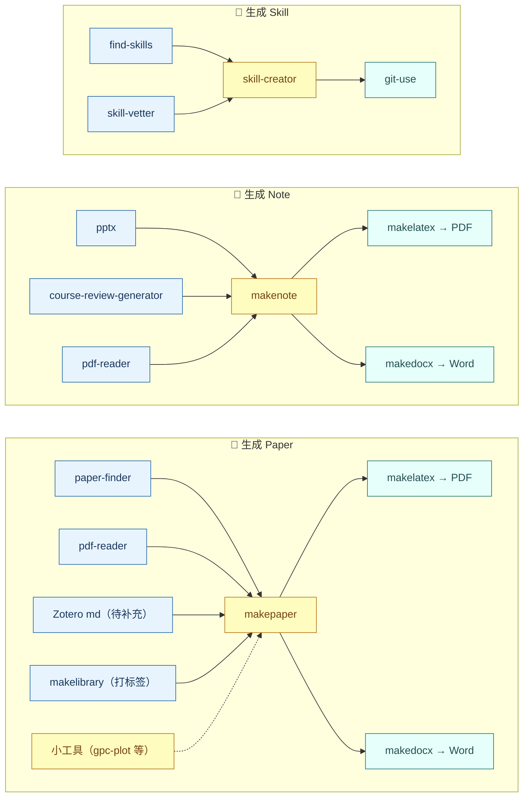

# 🧰 han-skills

个人常用 Codex 技能库，长期维护、持续更新。

一套面向 [Codex](https://openai.com/codex) 场景的个人技能（Skills）集合，覆盖文档排版、文献管理、科研绘图与数据处理、演示文稿、开发与技能管理等方向，当前共 **16 个技能**。

---

## 🚀 快速开始

```powershell
# 1. 克隆仓库
git clone https://github.com/han90059005/han-skills.git

# 2. 按需把技能复制到本地技能目录
Copy-Item -Path "han-skills\pdf-reader" `
          -Destination "$env:USERPROFILE\.agents\skills\pdf-reader" `
          -Recurse -Force
```

> 本地技能目录通常是 `C:\Users\<你的用户名>\.agents\skills`。一次只装需要的即可，装上后新开一个对话就能用自然语言触发。

## 📦 技能总览



> 说明：`skill-creator` 为 Codex 内置技能，不在本仓库；「Zotero md」为待补充来源占位；`uv-python-runner`、`raft-report-updater`、`zotero-paper-reader` 暂未画入主线。

## 📚 技能详情

### 📝 文档排版与笔记

#### course-review-generator

从课程 PPT（PDF）生成结构化复习笔记，或把多份已有的复习笔记/学习指南合并去重为一份 Markdown。支持扫描版 PDF 的视觉回读，可输出 Markdown 并可选转 PDF。

- **触发**：整理 PPT 复习资料 / 合并复习笔记 / 生成复习清单
- **相关**：内容生成后的排版交给 [makelatex](#makelatex)（PDF）或 [makedocx](#makedocx)（Word）

#### makenote

围绕一份固定 Markdown 笔记文件，随对话增量维护（新增、修改、订正、补充），自动维护「记忆快照区」以便跨会话续写。

- **触发**：/makenote / 做笔记 / 记笔记
- **相关**：批量生成复习资料用 [course-review-generator](#course-review-generator)

#### makepaper

读取文献 Markdown，合成带 `[n]` 角标引用的高质量中文论文/综述，输出可直接交给 makelatex 的 Markdown。

- **触发**：依据 md 资料写论文 / 综述
- **相关**：排版用 [makelatex](#makelatex)（PDF）或 [makedocx](#makedocx)（Word）

#### makelatex

把含 `[n]` 交叉引用的 Markdown 转成中文 PDF（XeLaTeX + ctex），正文引用渲染为角标并保留参考文献表。

- **触发**：Markdown 转 PDF / 含引用的文档排版
- **依赖**：TeX Live（xelatex）

#### makedocx

把 Markdown / LaTeX / XeLaTeX 转成符合中文论文规范的 Word，字体、标题字号、1.5 倍行距、三线表、公式、参考文献一步到位。

- **触发**：md/tex 转 docx / 三线表 / 论文排版
- **依赖**：pandoc + python-docx（无需 TeX Live）

### 📚 文献与 PDF

#### paper-finder

按关键词检索学术文献，校验元数据，分类下载开放获取 PDF，并生成 Markdown 内容备份。

- **触发**：查文献 / 下载 PDF
- **依赖**：校园网环境

#### zotero-paper-reader

从 Zotero 文献库读取和分析论文，自动搜索、转 Markdown 并保存到 Notes/PaperInMarkdown。

- **触发**：Zotero / 读论文
- **依赖**：Zotero Desktop 本地 API（localhost:23119）

#### pdf-reader

提取 PDF 中的文字（中英文），尽量保留格式；文本版走 pdfplumber/pymupdf，扫描版需 OCR。

- **触发**：读 PDF / 提取 PDF 文字
- **依赖**：uv 管理依赖

#### makelibrary

扫描文献 md 目录，按标签词表打标签并生成集中索引（JSON + 可读清单，清单按标签统计篇数）。读一遍原文；内容层之后按标签筛选、只读命中的文件。

- **触发**：文献库 / 打标签 / 建立索引
- **依赖**：本地运行，不联网

### 🔬 科研与数据

#### gpc-plot

解析 Agilent（Cirrus 软件）GPC 数据文件，绘制 EPS+TIF 色谱图；支持单文件、多曲线叠加、批量出图。

- **触发**：GPC / 色谱图 / SEC / 分子量分布
- **依赖**：matplotlib + numpy

#### raft-report-updater

读取 Excel 数据与已有 Markdown 报告，检测数据变更与矛盾，重新生成完整报告并按日期归档，适合以 Entry 编号组织的实验数据。

- **触发**：更新实验报告 / 加数据 / 添加实验

### 🎬 演示文稿

#### pptx

创建、读取、编辑 `.pptx` 文件：文本提取、模板与版式、演讲者备注、批注、合并与拆分等。

- **触发**：PPT / slides / presentation / .pptx 文件

### 🛠️ 开发与技能管理

#### git-use

本地项目与 GitHub 仓库互传：克隆、初始化后推送、令牌认证、`.gitignore` 与敏感信息检查，并涵盖本机实测故障（schannel→OpenSSL、代理、凭据管理器卡住、dubious ownership）。

- **触发**：git / github / push / clone / 上传

#### find-skills

发现并安装可用的 Agent 技能，回答"我怎么做 X""有没有能……的技能"类问题。

- **触发**：我怎么做 X / 找一个技能

#### skill-vetter

安装技能前的安全审查：检查危险标志、权限范围、可疑模式。

- **触发**：安装技能前审查

#### uv-python-runner

在 uv 管理的 Python 环境中执行脚本，处理中文路径、特殊字符文件名、依赖安装等。

- **触发**：uv run / pip 失败 / externally-managed-environment

## 🧱 环境依赖

| 依赖 | 用途 | 说明 |
| --- | --- | --- |
| Python + uv | pdf-reader、gpc-plot 等 | 系统自带 Python 3.9/3.12 或 uv 均可 |
| pandoc ≥ 3.0 | course-review-generator、makedocx | 安装于 `C:\Program Files\Pandoc` |
| TeX Live（xelatex） | makelatex、pandoc 出 PDF | 完整版安装于 `D:\AI-tools\latex\texlive\2026` |
| Zotero Desktop | zotero-paper-reader | 需开启本地 API |
| matplotlib + numpy | gpc-plot | 系统 Python 或 `uv run --with` |

## 🗂️ 目录结构

```text
han-skills/
├── course-review-generator/
├── find-skills/
├── git-use/
├── gpc-plot/
├── makelatex/
├── makelibrary/
├── makenote/
├── makepaper/
├── makedocx/
├── paper-finder/
├── pdf-reader/
├── pptx/
├── raft-report-updater/
├── skill-vetter/
├── uv-python-runner/
└── zotero-paper-reader/
```

## 🔄 维护约定

- **新增技能**：复制到本仓库根目录，并按分类同步更新「技能总览」和「技能详情」。
- **修改技能**：同步更新对应详情、触发词与描述。

## 📋 示例工作流：小作业速成链

适用于「查文献 → 写论文 → 出 PDF」的课程小论文、综述或读书报告。

```text
作业目录/
├── literature/        ← 文献摘要 md（paper-finder 生成）
└── 论文.md / 论文.pdf  ← makepaper → makelatex 的产物
```

1. **检索文献**（paper-finder）：按关键词检索并导出清单。

```powershell
py C:\Users\admin\.agents\skills\paper-finder\scripts\paper_finder.py search "关键词" -o literature --limit 20
```

打开 `literature\search_关键词.md`，筛选想要的文献并记下 DOI。

2. **保存摘要**（paper-finder，只存摘要、不下全文）：对每篇选中的文献执行——

```powershell
py C:\Users\admin\.agents\skills\paper-finder\scripts\paper_finder.py get <DOI> -o literature --category 分类 --no-pdf
```

生成的 md 以 `## 摘要` 标记，makepaper 能直接识别为「摘要级」来源。

3. **合成论文**（makepaper）：让 Codex 读取 `literature` 里的 md，按题目要求写中文论文，输出 `论文.md`（带 `[n]` 角标引用）。

4. **生成 PDF**（makelatex）：

```powershell
py C:\Users\admin\.agents\skills\makelatex\scripts\md_to_latex_pdf.py 论文.md -o 作业目录
```

生成 `论文.pdf`，检查正文角标与文末参考文献。

> 定位：摘要级引用，适合综述型小作业；需要深挖方法/数据时，第 2 步去掉 `--no-pdf` 下载全文，再用 pdf-reader 转全文。

## 📝 更新日志

### 2026-10-16

- 新增 `git-use` 技能：本地与 GitHub 互传的完整流程。
- 合并技能：删除 `three-line-table-docx`（功能并入 `makedocx`）；将 `multi-source-review-consolidator` 并入 `course-review-generator`。
- 重命名：`md-latex-to-docx` → `pandoc-docx` → `makedocx`。
- 为笔记类技能写清各自侧重点，避免互相抢任务。
- 重写 README：分类总览、触发词、安装指引、环境依赖与目录结构。
- 本地技能目录直连 GitHub，更新统一经 GitHub 同步（单仓库工作流）。
- `paper-finder` 新增 `--no-pdf`：只存 `## 摘要`，不下载全文。
- `makelatex` 从 Tectonic 切换到 TeX Live 的 `xelatex`。
- 安装完整 TeX Live 2026 于 `D:\AI-tools\latex\texlive\2026` 并加入 PATH。
- README 新增「小作业速成链」示例工作流。
- 技能总览从表格改为横向流程图（Paper / Note / Skill 三条生成主线）。
- `pandoc-docx` 重命名为 `makedocx`，与 makepaper / makelatex / makenote 命名对齐。
- 内容层（makepaper、makenote）新增「输入接口（归一化）」；成品层（makelatex、makedocx）新增「运行可靠性」。
- 新增 `makelibrary`：文献 md 打标签 + 生成集中索引；makepaper 增加按标签筛选的阅读检索入口与低/高强度机制。

